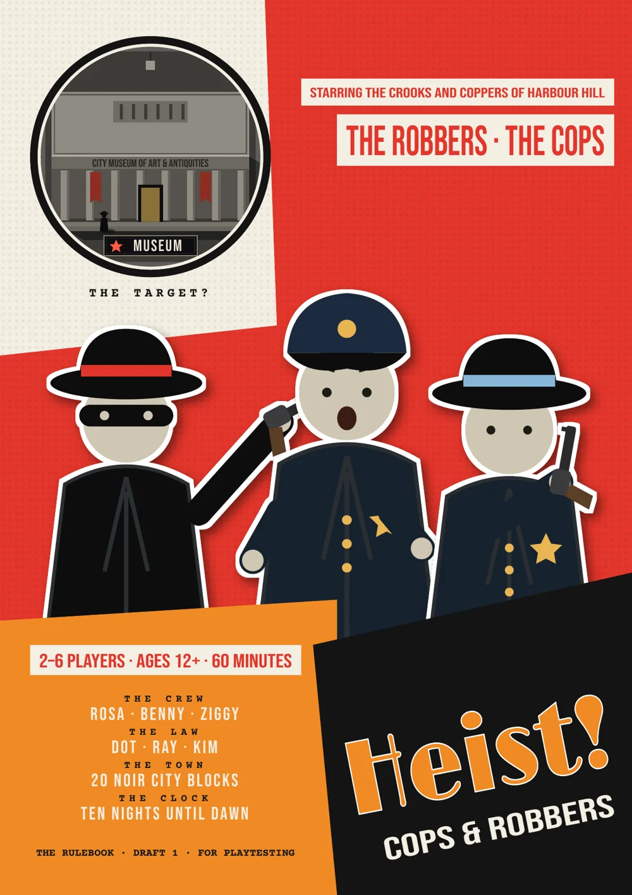

<p align="center"></p>

<h1 align="center">Heist! · Cops &amp; Robbers</h1>

<p align="center"><b>One town. One secret target. Ten nights until dawn.</b><br>
A team board game of secret plans, open chases and one unanimous accusation.</p>

<p align="center">
2–6 players · ages 12+ · about 60 minutes · two teams · Draft 1, now playtesting
</p>

---

The robbers know exactly what they're after. The cops don't, and every one of them has to agree before they can slap on the cuffs. Every shop the gang visits is a clue, every move is planned in secret, and every card you spend leaves a trail.

Build a new 1940s noir town every game from 20 city blocks, bluff with decoys, chase suspects through the fog at the docks, and wonder whether the cop beside you is on the take.

**Website:** open [`index.html`](index.html), or turn on GitHub Pages for this repo (Settings → Pages → deploy from the `main` branch, root folder).

## Downloads

| | |
|---|---|
| 📕 [Rulebook (A4 PDF, 19 pages)](rules/heist-rulebook-A4.pdf) | Five modes, glossary, worked example, clarifications |
| ✂️ [Print & play kit (A4 PDF, 15 sheets)](print-and-play/heist-print-and-play-A4.pdf) | Every tile, card, token, standee and mat. Print double-sided, flip on the long edge. |

## The game in 30 seconds

- **Two even teams.** Each always moves a crew of 3 pawns, so 2, 4 and 6 players all play the same.
- **Robbers** secretly draw a job (Bank, Museum, Jewellery Store, Casino or Grand Hotel), collect the 3 items it needs from shops around town, and play **Heist!** on the target to win.
- **Cops** watch, search, chase and set roadblocks. They win with a **correct, unanimous accusation**, or if dawn breaks after Night 10.
- **Every night is simultaneous.** Both teams place face-down destination tokens (plus decoys) and action cards, then everything flips at once.
- **A new town every game.** 16 of 20 tiles in a 4×4 grid. Change the town and you change which jobs are possible.

## Explore the project

| Page | What's in it |
|---|---|
| [Overview](docs/overview.md) | Pitch, theme, the two teams, what makes it different |
| [How to play](docs/how-to-play.md) | A short rules summary of a night, actions and winning |
| [Components](docs/components.md) | Everything in the box, with counts and pictures |
| [Design notes](docs/design-notes.md) | The ideas behind the game and the decisions made so far |
| [Roadmap](docs/roadmap.md) | Where the project is and the open playtest questions |
| [Playtesting](docs/playtesting.md) | How to run a test game and send a report |
| [Design history](docs/design-history/) | The original brainstorm documents |
| [Art gallery](assets/art/) | All draft art as images |
| [Credits](CREDITS.md) · [Licence](LICENSE.md) | Who made what, and how you may use it (CC BY-SA 4.0) |

## Repository layout

```
index.html               the project homepage
assets/                  cover, social preview image
assets/art/              92 draft art images (tiles, cards, pawns, tokens, mats)
rules/                   rulebook PDF
print-and-play/          print & play PDF
docs/                    overview, rules summary, components, design notes, roadmap
docs/design-history/     brainstorm documents
.github/ISSUE_TEMPLATE/  playtest report form
```

## Status

**Draft 1.** The rules and art are complete enough to play, and every number is a first guess. Playtest reports are very welcome: see [Playtesting](docs/playtesting.md).
