# Components

All art is draft art for playtesting, drawn as one 1940s film-noir world. Every piece is in the [print & play kit](../print-and-play/heist-print-and-play-A4.pdf).

| Count | Component | Notes | Print size |
|---|---|---|---|
| 20 | Town tiles | 3 always in, 5 targets, 6 suppliers, 6 specials. 16 used per game. | 90 × 90 mm |
| 1 | Dawn track | 10 nights, shift changes after 3, 6 and 8 | 2 strips, 344 mm |
| 6 | Pawn standees | Robbers 1–3, Cops 1–3 | 30 × 45 mm fold-over |
| 6 | Specialist standees (optional) | Locksmith, Getaway Driver, Lookout, Detective, Dog Handler, Sergeant | 30 × 45 mm |
| 6 | Destination tokens | One per pawn, matching numbers | 22 mm round |
| 4 | Decoy tokens | 2 per team | 22 mm round |
| 1 | Stakeout token | | 22 mm round |
| 1 | Roadblock token | | 22 mm round |
| 2 | Accusation tokens | | 22 mm round |
| 1 | Dawn marker | | 22 mm round |
| 32 | Item tokens | 4 each: Drill, Glass Cutter, Disguise, Getaway Car, Guard Schedule, Blueprints, Uniform, Master Key | 22 mm square |
| 7 | Robber action cards | Grab ×3, Scout ×2, Lie Low ×1, Heist! ×1 | 63 × 88 mm |
| 6 | Cop action cards | Search ×2, Chase ×2, Roadblock ×1, Stakeout ×1 | 63 × 88 mm |
| 5 | Goal cards | One per target | 63 × 88 mm |
| 5 | Witness cards | "It wasn't the…", one per target | 63 × 88 mm |
| 8 | Loyalty cards | Loyal ×6, Double Agent ×2 | 63 × 88 mm |
| 6 | Event cards | Street Parade, Museum Gala, Power Cut, Night Shift Bonus, Bribe, Snitch | 63 × 88 mm |
| 2 | Team mats | The Hideout table (robbers), the precinct desk (cops) | 131 × 277 mm |
| 1 | Rulebook | 19 A4 pages | A4 |

The item token count (4 per item) is a first guess.

## The 20 tiles

| Group | Tiles |
|---|---|
| Always in | Hideout, Police Station, Hardware Store |
| Targets (use 4) | Bank, Museum, Jewellery Store, Casino, Grand Hotel |
| Suppliers (use 5) | Theatre (Disguise), Garage (Getaway Car), Café (Guard Schedule), Town Hall (Blueprints), Laundromat (Uniform), Pawn Shop (Master Key). The Hardware Store supplies Drill or Glass Cutter. |
| Specials (use 4) | Park (quiet), Main Street (parade route), Train Station (fast travel), Market (crowds), Harbour Docks (fog), Daily Herald (tip-off) |

## Pictures

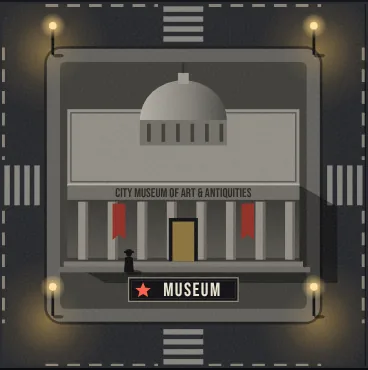
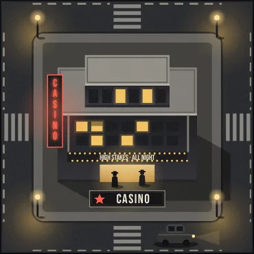
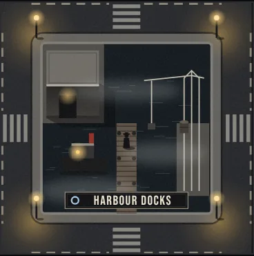
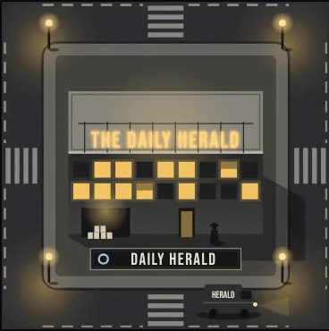

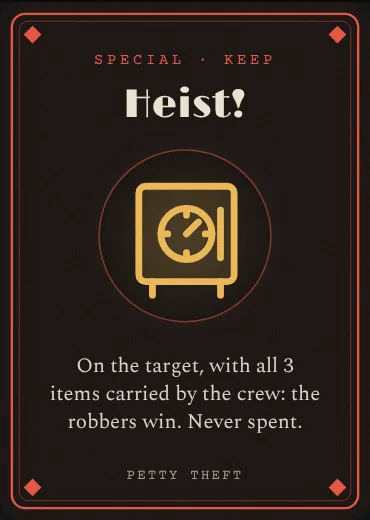
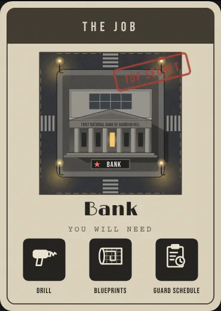
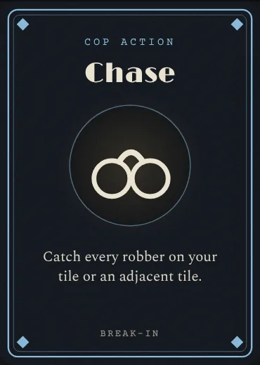
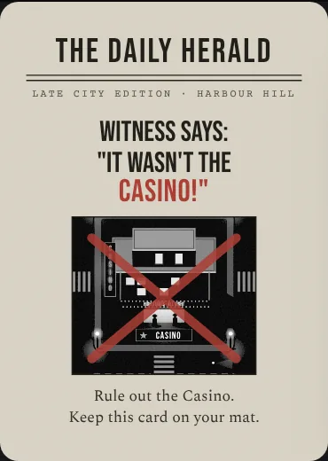
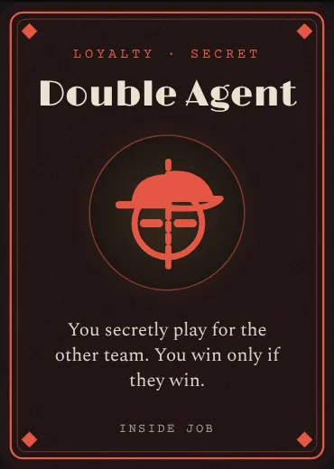

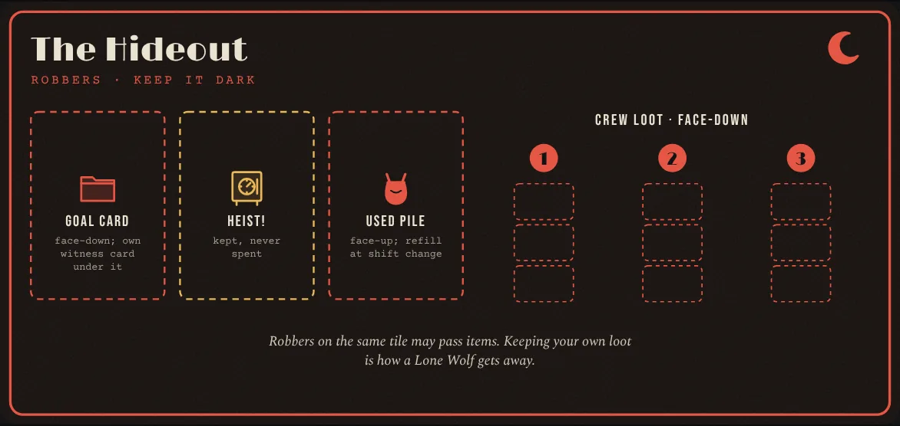
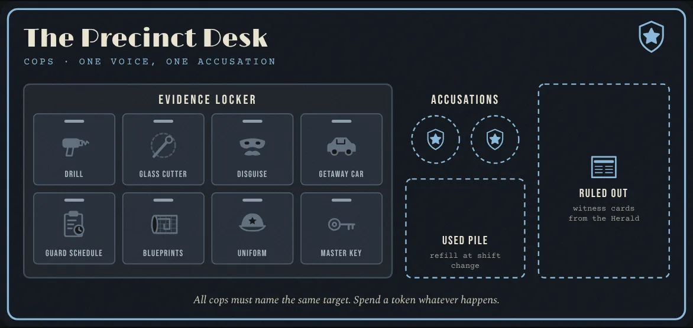

See the homepage gallery, or browse [assets/art](../assets/art/), for every piece.
